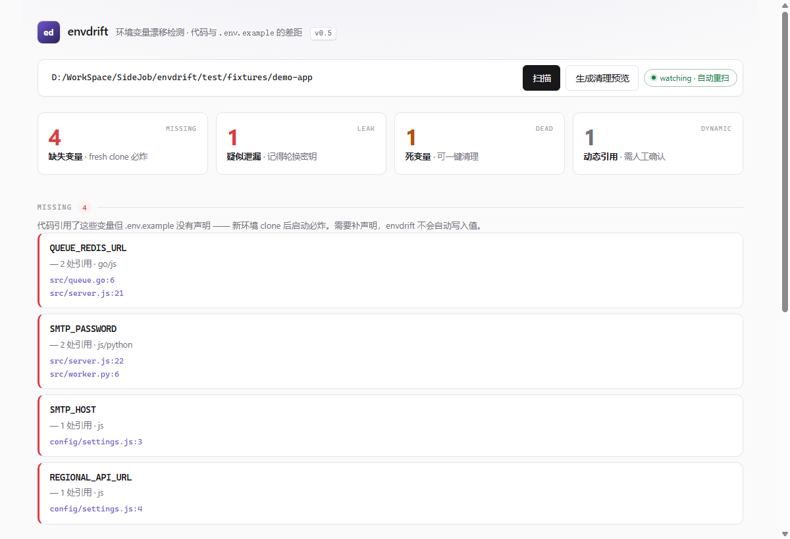
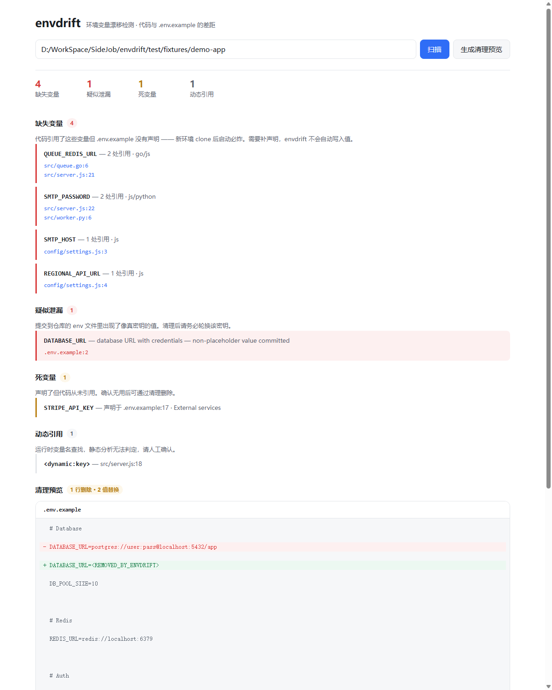
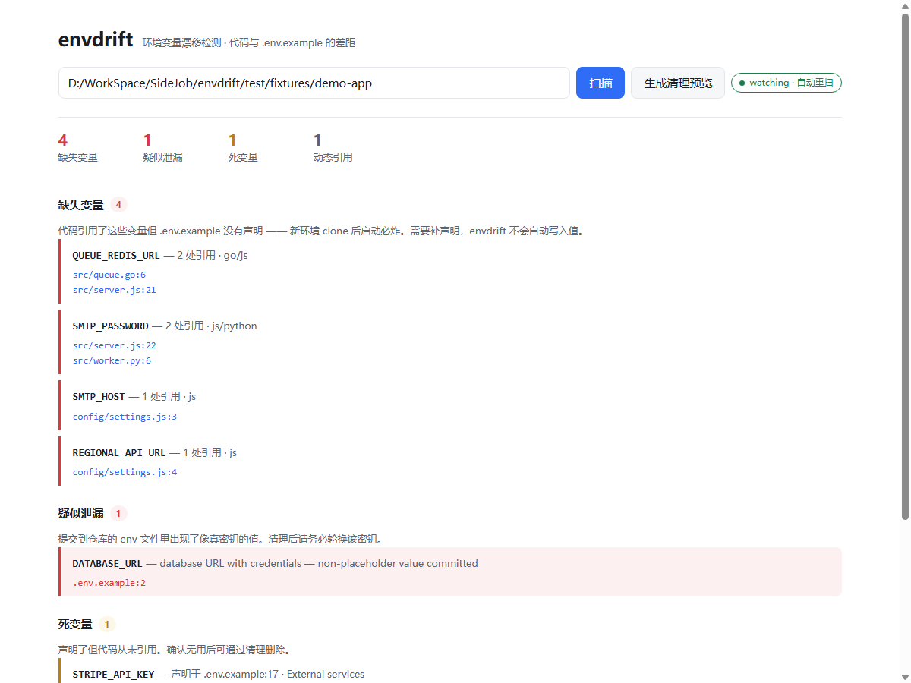

# envdrift

[](https://github.com/HTempt/envdrift/actions/workflows/ci.yml)

**Detect environment variable drift** — the gap between what your code actually reads and what `.env.example` declares.

The pain it solves: a fresh `git clone` + `npm install` + `npm run dev` crashes with `undefined` config, because someone added `process.env.NEW_THING` to code but never updated `.env.example`. Nobody notices until the next person (or the CI, or an AI agent in a fresh sandbox) hits it.

## What it detects

| Category | Meaning | CI exit code impact |
|---|---|---|
| `missing` | env vars referenced in code but absent from `.env.example` | **fails (1)** |
| `leaks` | real-looking secrets committed in `.env.example` (DB URLs, API keys, JWTs…) | **fails (1)** |
| `dead` | declared in `.env.example` but never referenced anywhere | warning only |
| `dynamic` | dynamic lookups (`process.env[name]`) that can't be statically checked | info only |

## Install & run

```bash
# from source (v0.1)
git clone <this-repo> && cd envdrift && npm install && npm run build
node dist/cli.js /path/to/project
```

```text
envdrift · my-api
scanned 164 files · 23 unique env refs · 19 vars in example

✗ missing from .env.example (2) — will crash on a fresh clone
  QUEUE_REDIS_URL  used in src/queue.go:6 (2×, go/js)
  SMTP_PASSWORD    used in src/server.js:22 (2×, js/python)

⚠ possible leaked secrets in committed env files (1)
  DATABASE_URL  .env.example:2 — database URL with credentials — non-placeholder value committed

~ declared but unused (1) — candidate dead vars
  STRIPE_API_KEY  .env.example:17 — External services

? dynamic lookups not statically checkable (1)
  <dynamic:key>  src/server.js:18
```

## Languages supported (read side)

`js/ts/tsx/mjs/cjs` (`process.env.X`, `import.meta.env.X`, `Deno/Bun.env.get`)
· `python` (`os.environ[...]`, `os.environ.get`, `os.getenv`)
· `go` (`os.Getenv`, `os.LookupEnv`)
· `java/kotlin` (`System.getenv`)
· `rust` (`env::var`)
· `ruby` (`ENV[...]`, `ENV.fetch`)
· `php` (`getenv`, `$_ENV`)
· `c#` (`Environment.GetEnvironmentVariable`)
· `yaml` (docker-compose `- KEY=` list style)

## Spring Boot support (v0.2)

When a project contains `application.properties` / `application.yml`, envdrift switches to Spring mode:

- **Declarations**: every key in `application.properties`/`application.yml` counts as declared (`spring.datasource.url`, `app.upload-dir`, …)
- **Usages**: `@Value("${prop.name}")` and `@Value("${prop.name:default}")`, `environment.getProperty("prop.name")`, plus `${VAR}` placeholders consumed *inside* property values (`spring.datasource.password=${DB_PASSWORD}`)
- **Relaxed binding**: `@Value("${app.featureLegacy.enabled}")` matches declared `app.feature-legacy.enabled` — dashes/case are canonicalized exactly like Spring does
- `DB_PASSWORD` consumed by a placeholder but declared nowhere → reported missing (a fresh clone really would crash)
- Framework-managed keys (`spring.*`, `springdoc.*`) that nothing reads show up as *declared but unused* — a useful hygiene signal, ignore them if you prefer

## AI-agent friendly

`--json` emits a stable schema with a `summary.exitCode` field — designed for MCP servers, CI bots, and coding agents that provision their own sandboxes:

```bash
envdrift --json | jq '.summary'
```

## Options

```
envdrift [path]
  --json              JSON output
  --allow A,B         extra variable names to ignore (built-in list always applies)
  --env-file FILES    comma-separated declaration files
                      (default: .env.example,.env.sample,.env.template,.env.defaults)
  --no-local          ignore local .env when judging what is "missing"
```

Exit codes: `0` clean · `1` missing vars or leaked secrets · `2` tool error.

## Auto-cleanup (`--fix`)

```bash
envdrift --fix              # highlight problems → preview → confirm → apply
envdrift --fix --dry-run    # preview only, write nothing
envdrift --fix --yes        # skip the prompt (scripts)
envdrift --fix --json       # machine-readable plan (for AI agents)
```

The report itself now highlights the offending config line inline (`│ KEY=value`),
with leak values masked to the first 4 characters. `--fix` turns findings into a plan:

- **dead var** → line deleted; its doc comment becomes a tombstone `# removed by envdrift: KEY`
- **leak, var still used** → value neutralized in place: `KEY=<REMOVED_BY_ENVDRIFT>` (rotate the real secret!)
- **dead AND leaked** → line deleted entirely (a placeholder for an unused secret has no value)
- missing vars are **never** auto-written — they need real values only you know

After writing, every touched file is re-parsed to guarantee it still parses, and a
before/after dead+leak count is printed.

## Web dashboard (v0.4)

Prefer pointing and clicking over the terminal? The same engine ships with a local web UI:

```bash
envdrift-ui <project-path> [port]   # default port 3737, binds 127.0.0.1
# e.g.
envdrift-ui D:/WorkSpace/SideJob/api
```

Then open the printed URL. The dashboard gives you the full `--fix` flow with zero terminal:

1. **Scan** — paste any project path, get the drift report as color-coded sections
   (missing / leaks / dead / dynamic) with counts up top
2. **Highlight** — each finding shows its file:line refs; leak rows are tinted red,
   dead rows amber
3. **Preview** — one click builds the cleanup plan and renders it as a red/green diff
4. **Apply** — confirm, files are cleaned, results verified and re-analyzed live





No framework, no build step, no external requests: a single static HTML file served
by the same process that runs the analysis. Data never leaves your machine.

### Watch mode

After the first scan the dashboard automatically subscribes to file changes — the
green pill in the header shows `● watching · 自动重扫`:

- any change to scanned source files or `.env*` declaration files under the project
  triggers a debounced re-scan (400 ms) and the report refreshes live
- the pill turns amber (`文件已变更 · 重扫中…`) while re-scanning
- watch is recursive and shared per project; run `envdrift-ui` on a monorepo root and
  edits anywhere in the tree update the report
- if the server closes, the UI silently falls back to manual scanning



## Design notes

- Static-analysis only — fast, no execution, no config needed. Dynamic lookups are reported, not guessed.
- Placeholder-aware leak detection: `JWT_SECRET=changeme` is fine; `DATABASE_URL=postgres://user:pass@db:5432/x` is a leak.
- Built-in allowlist for runtime-injected vars (`NODE_ENV`, `PORT`, `RUST_LOG`, `CI`, proxies…) so fresh projects aren't noisy.

## Roadmap

- dashboard: jump-to-editor links (vscode://), watch mode with live re-scan
- git pre-commit hook + GitHub Action
- MCP server wrapper
- interpolation resolution (non-Spring `${OTHER_VAR}` chains in .env files)
- YAML Spring config with nested `spring:` indentation blocks (flat keys only today)

MIT
